<p align="center">
  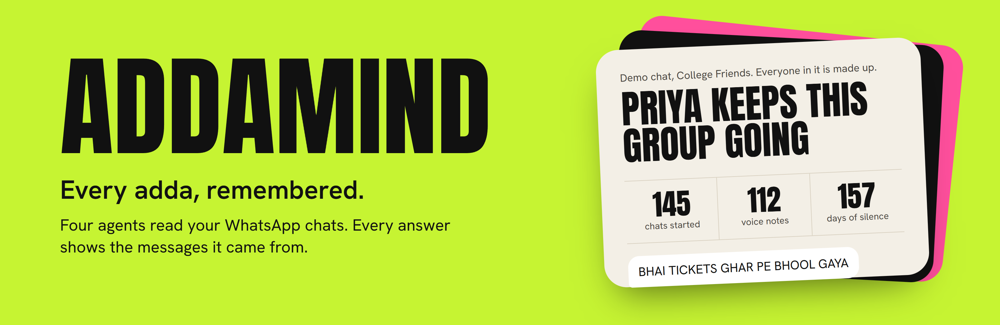
</p>

<p align="center">
  <b>Four agents that read your WhatsApp chats and answer with receipts.</b><br>
  Every claim links back to the message it came from.
</p>

<p align="center">
  
  
  
  
</p>

<p align="center">
  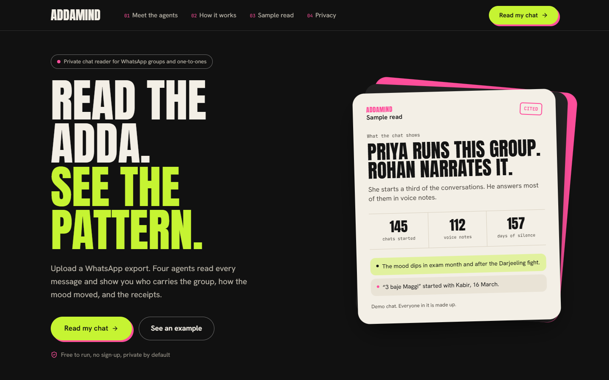
</p>

Built for Agentic Chase, Mission 04 (Multi-Agent Chat Intelligence Platform).

## See it work

| | |
|---|---|
| 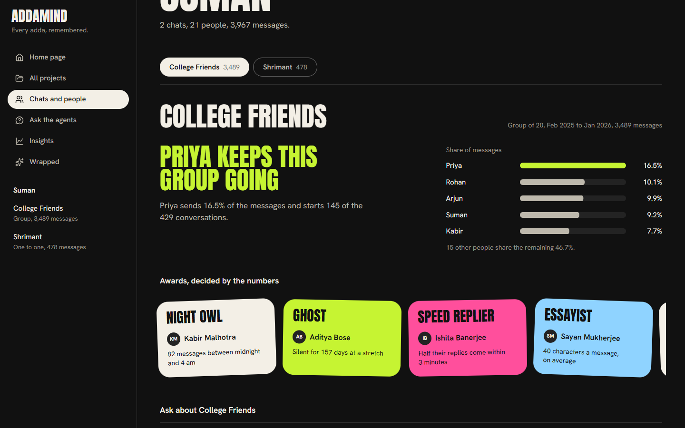 | 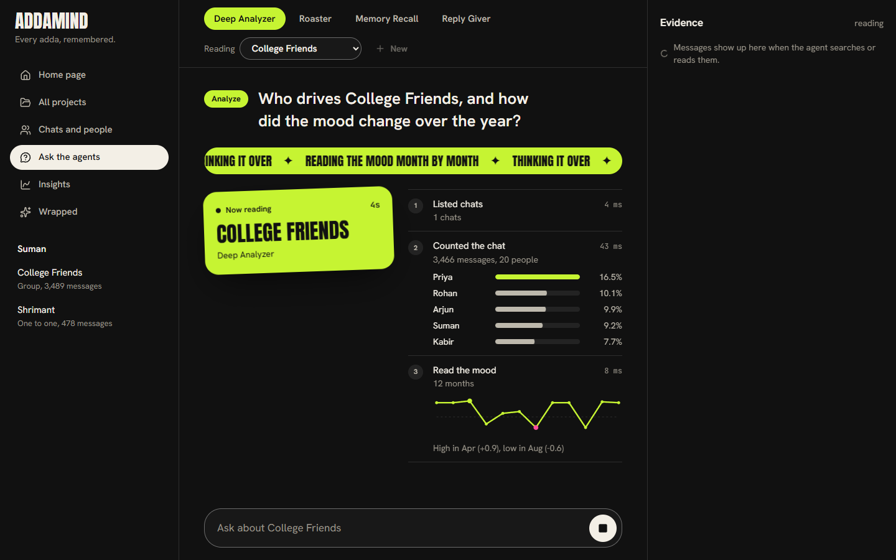 |
| **First read.** Drop an export and get a read of the chat before you ask anything. | **On air.** Tool calls stream in as the agent works. |
| 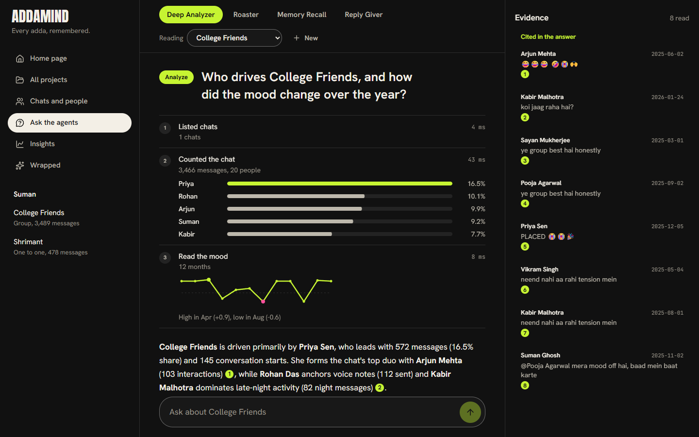 | 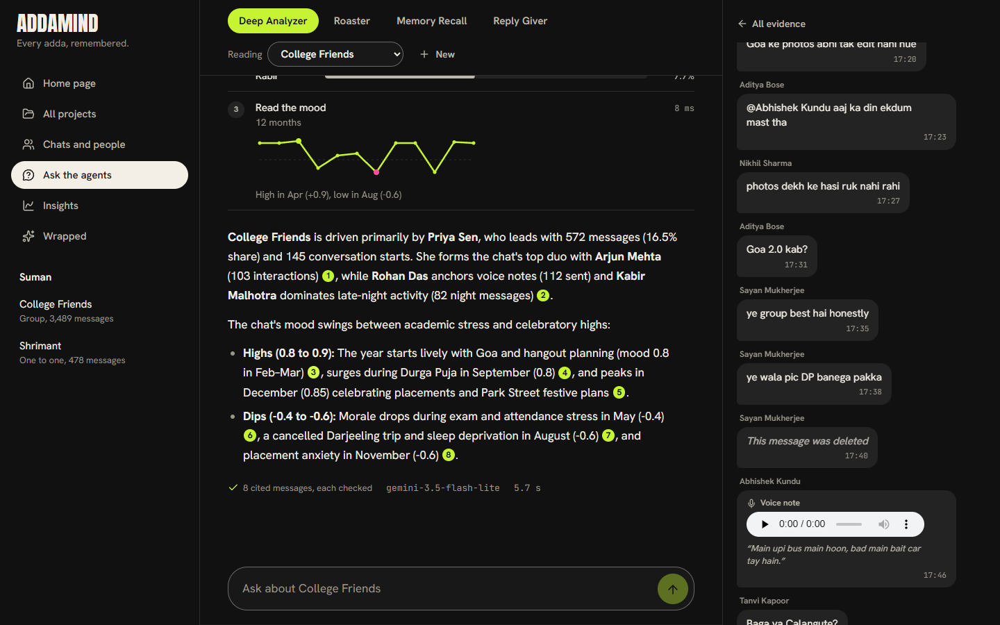 |
| **Answers with receipts.** Every `[m:ID]` opens the original message. | **Evidence panel.** The message, the context around it, the date. |
| 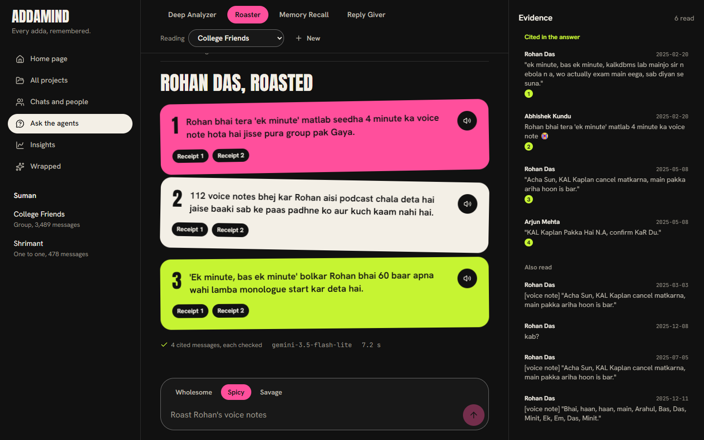 | 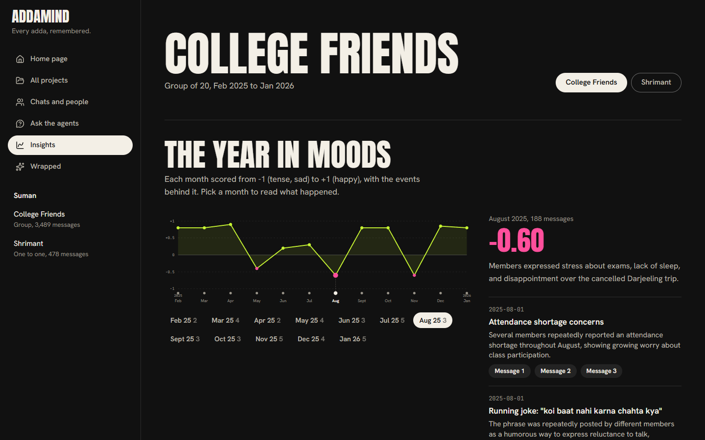 |
| **Roaster.** Wholesome, spicy or savage, and it can read aloud. | **Mood timeline.** Events pinned to the highs and dips. |
| 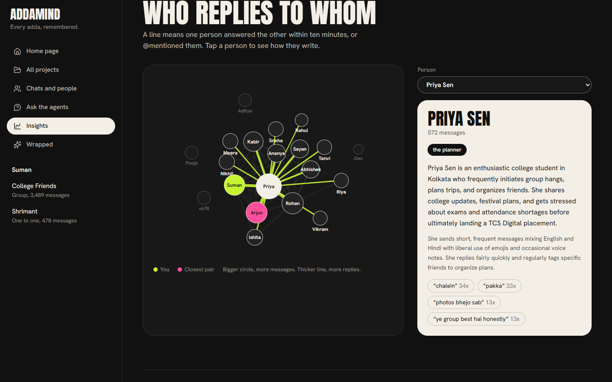 | 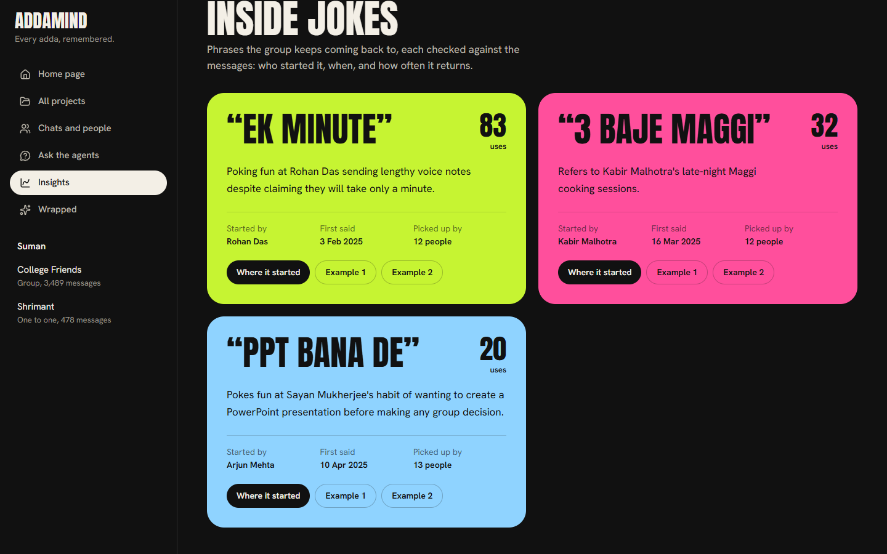 |
| **Who replies to whom.** Built from counts, not guesses. | **Inside jokes.** Kept only if the database confirms them. |

<table>
  <tr>
    <td>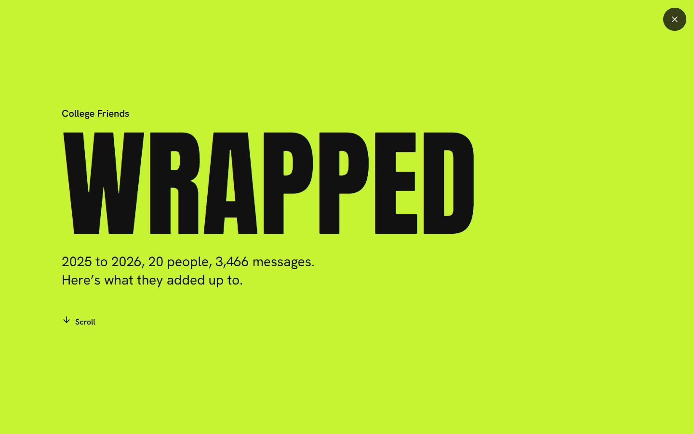</td>
    <td>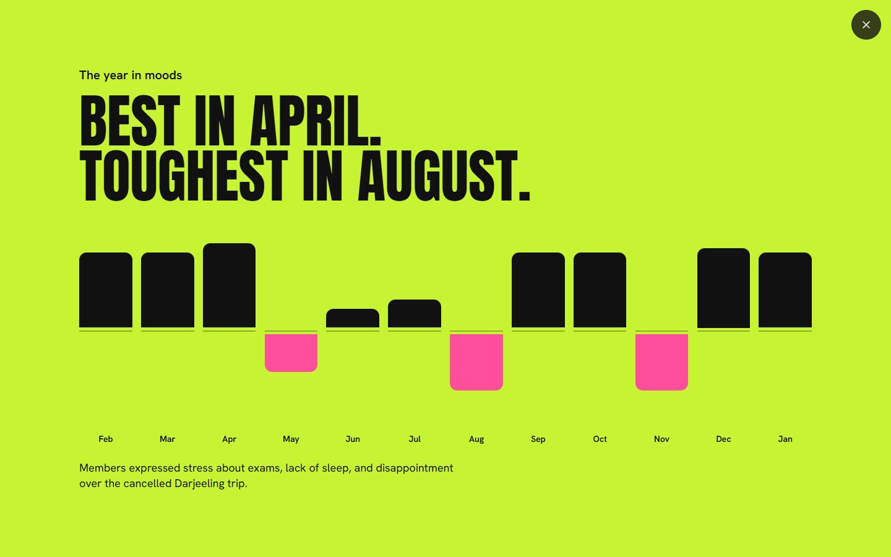</td>
    <td>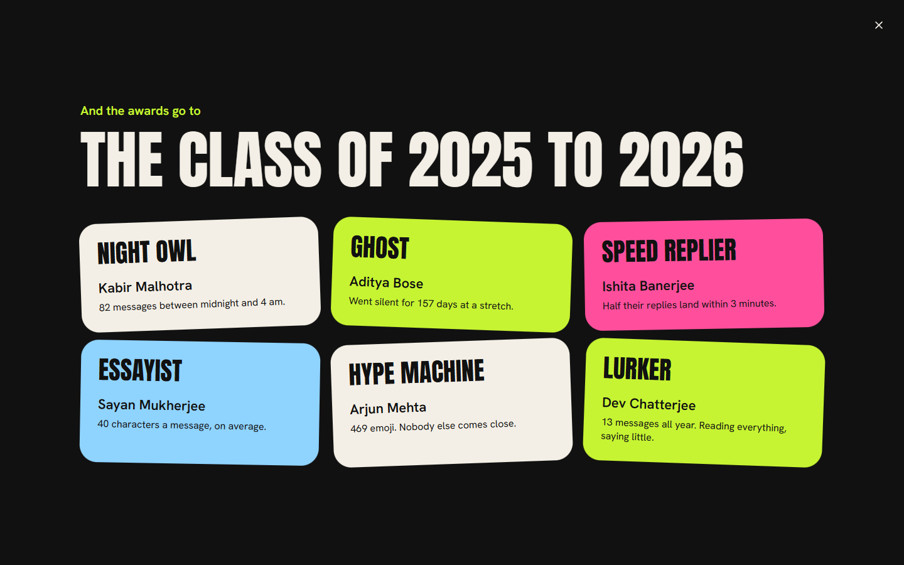</td>
    <td>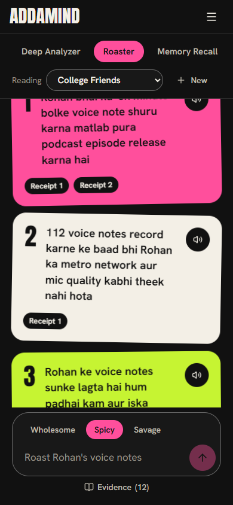</td>
  </tr>
</table>

<p align="center"><sub>Group Wrapped, and the same app on a phone.</sub></p>

## Try these questions

On the demo data:

- Who started most of the conversations?
- Who backed out of the Goa trip?
- When did the group's mood dip, and why?
- Roast Aditya for going silent. Savage.
- Give me replies to "kab aa rahe ho?" in my style.
## What it does

- **Projects** hold any number of group and one-to-one chats. Upload the `.zip` (with media) or `.txt` that WhatsApp's
  Export chat produces, from Android or iPhone. A newer export of the same chat only adds the new messages.
- **People** are matched across chats by name. You mark which one is you, and anyone can be switched off from roasts.
  Phone-number senders are masked.
- **Media**: photos and videos are described, voice notes transcribed, PDFs read. All of it becomes searchable.
- **Memory**: each month is summarised (topics, events, mood from -1 to 1), then rolled into a timeline, a mood series,
  group dynamics and an inside-joke dictionary. Personas describe how each person writes.
- **Four agents**, each at project, chat or person scope:
  - Deep Analyzer: who drives the chat, participation, mood over time, key moments.
  - Roaster: playful roasts of habits, in a wholesome, spicy or savage tone, which can be read aloud.
  - Memory Recall: "when did we", "who said", "what was the plan", with the date.
  - Reply Giver: three to five replies in your own style, ready to copy.
- **Insights**: the mood timeline with events pinned to it, a who-replies-to-whom graph, and the inside jokes.
- **Group Wrapped**: a scrolling story of the year, built only from counts and memory.

## How answers stay grounded

- Counts, rankings, dates and awards come from SQL (`backend/chatintel/analytics.py`), never from a model.
- Agents only see the chats through tools (`backend/chatintel/tools.py`). The tools enforce the scope, and every message
  they return is tagged `[m:ID]`.
- The final answer may cite only IDs the tools returned in that run. Anything else is removed before it is shown
  (`agents.check_citations`).
- Inside jokes and catchphrases proposed by a model are kept only if the database confirms them: enough uses, by more than
  one person, in different messages.
- Roasts: requests about protected topics (looks, health, religion, caste, ethnicity, gender, disability, money, family,
  trauma) and people who opted out are refused before any model call. Each roast then gets a keyword check and a second
  model check that rewrites or drops unsafe lines (`backend/chatintel/safety.py`).

## Architecture

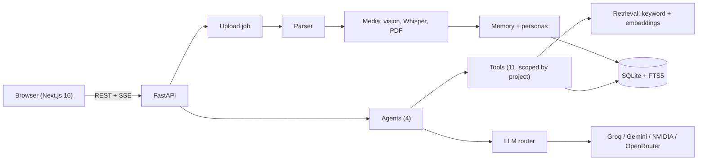

Where things live:

```
frontend/                      Next.js: landing, studio, Ask, Insights, Wrapped
backend/api/                   app entry
backend/chatintel/             parser, ingest, analytics, retrieval, media, memory,
                               personas, tools, agents, safety, voice, api
backend/core/                  agent loop, structured output, key rotation, llm/ router
scripts/                       make_demo_data, load_demo, eval_scenario
tests/
```

Upload progress and agent runs stream to the browser as Server-Sent Events. Everything is stored in one SQLite file
(`.cache/addamind.db`) with media files beside it. Every query is scoped by project, and deleting a chat or project
removes its rows and files.

### Models

All free tiers, each with a fallback chain (see `.env.example`):

| Job | Primary | Fallback |
|---|---|---|
| Agents | Groq `gpt-oss-120b` | Gemini Flash-Lite, Groq Qwen, OpenRouter, NVIDIA |
| Monthly summaries, personas | Gemini Flash-Lite | other Gemini models, NVIDIA Nemotron |
| Photos, videos | Gemini Flash-Lite | none (marked failed, processing continues) |
| Voice notes | Groq Whisper large v3 turbo | Gemini audio |
| Embeddings | NVIDIA Nemotron embed | Gemini embedding; keyword search alone if both fail |
| Spoken roasts | Gemini TTS | the browser's voice |

## Run it

Python 3.13 and Node 20 or newer.

```powershell
python -m venv .venv
.\.venv\Scripts\python.exe -m pip install -r requirements-dev.txt
copy .env.example .env    # then add your API keys

# demo data (synthetic chats; everyone in them is made up)
.\.venv\Scripts\python.exe -m scripts.make_demo_data
.\.venv\Scripts\python.exe -m scripts.load_demo --reset

# API on :8000
.\.venv\Scripts\python.exe -m uvicorn backend.api.main:app --port 8000

# web app on :3000
cd frontend
npm install
npm run dev
```

Loading the full demo takes about ten minutes, mostly media analysis within free-tier rate limits.

### More than one API key

Each provider can have several keys (`GEMINI_API_KEYS=a,b,c`, same for `GROQ_API_KEYS`, `NVIDIA_API_KEYS` and
`OPENROUTER_API_KEYS`). The router tries every key of a model before it moves to the next model, rests a rate-limited key
for a minute (or the time the provider asks for), and drops a key the provider refuses. Voice notes, photo descriptions,
embeddings and spoken roasts rotate keys the same way (`backend/core/keys.py`). `GET /health` reports how many keys each
provider has and how many are ready, resting or refused, never the keys themselves. Check the provider's terms before
using keys from several accounts.

## Checks

```powershell
.\.venv\Scripts\python.exe -m pytest tests -q        # unit and API tests, no network
.\.venv\Scripts\python.exe -m scripts.eval_scenario  # the demo questions against live models
cd frontend; npx tsc --noEmit; npm run lint
```

`scripts/eval_scenario.py` asks every demo question through the real agents and checks the answers against the facts
planted in the demo data (`data/demo/facts.json`): the right people named, the mood dips mentioned, real messages cited.

## Privacy

Chats stay on the server that runs AddaMind. Photos, videos and voice notes are sent to the model providers only to be
described or transcribed; message text goes to them only inside agent and summary prompts. Nothing is logged with message
text. Projects never read each other's data.

## Credits

Next.js, Tailwind CSS, Framer Motion, GSAP, Lenis, d3-force, Lucide, FastAPI, pypdf, NumPy. Fonts: Anton, Hanken Grotesk,
JetBrains Mono (Google Fonts, OFL). The landing page's content, visuals and code are AddaMind's own.
